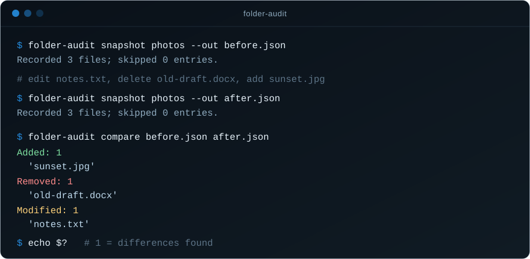

# Folder Change Auditor

[](https://github.com/Frotart/folder-change-auditor/actions/workflows/ci.yml) [](https://github.com/Frotart/folder-change-auditor/releases) [](https://www.python.org/) [](LICENSE)

**What changed in this folder?** Take a SHA-256 snapshot before, take another
after, and compare them. Folder Change Auditor lists every added, removed and
modified file, entirely offline, using only Python's standard library.

<p align="center">
  
</p>

## Why

Moving, cleaning up or backing up files is easy to get slightly wrong. A sync
tool quietly skips a folder, a cleanup removes one file too many, or a copy
finishes with a different version of a document. Folder Change Auditor gives you
a precise, content-based answer instead of a guess:

- **Verify a backup or migration** — snapshot the original and the copy, and
  confirm nothing is missing or different.
- **Audit a cleanup** — snapshot before reorganizing, snapshot after, and review
  exactly what was removed.
- **Spot unexpected changes** — see which files in a folder changed since last
  week.

It never changes, deletes or uploads anything in the folder it scans. It has no
network client and no telemetry.

## Install

Requires Python 3.12 or newer. No third-party packages.

```shell
pipx install git+https://github.com/Frotart/folder-change-auditor
folder-audit --version
```

`pip install git+https://github.com/Frotart/folder-change-auditor` works too.
Or skip installing: download `folder_auditor.py` from the
[latest release](https://github.com/Frotart/folder-change-auditor/releases/latest),
check it against that release's `SHA256SUMS.txt`, and run
`python folder_auditor.py` anywhere `folder-audit` appears below.

## Quick start

```shell
folder-audit snapshot ./demo-source --out ./before.json
# ...make your changes to demo-source...
folder-audit snapshot ./demo-source --out ./after.json
folder-audit compare ./before.json ./after.json
folder-audit compare ./before.json ./after.json --json
```

Try it with disposable synthetic files first (from a clone of this repository):

```shell
python examples/demo.py
```

The demo runs the real command-line tool, checks its results, and removes its
temporary folder. Expected diff:

```json
{
  "added": ["added.txt"],
  "removed": ["removed.txt"],
  "modified": ["changed.txt"]
}
```

### Rules for snapshot files

- Use a **new output filename** each time. Existing files, directories and
  dangling links are never overwritten.
- The output's parent folder must already exist, and snapshots should be kept
  **outside** the scanned folder.
- Source and output paths must have no symlink or Windows reparse-point
  components, including junctions. Use their actual paths.
- Output requires a filesystem that supports hard links (tested on NTFS and
  local Linux filesystems).

Snapshot paths use `/` separators and are case-sensitive strings. Unicode and
spaces are supported; terminal output escapes non-ASCII characters for
predictable display. Snapshots reject ambiguous or unsafe relative paths,
including absolute paths, `..`, empty components, backslashes, colons, and
Unicode control, format or surrogate characters. A real source filename like
that aborts the scan rather than creating a snapshot that cannot be validated
later.

### Exit codes

| Code | Meaning |
| --- | --- |
| `0` | Snapshot saved, or compared recorded files are unchanged. |
| `1` | Compared recorded files differ. This is an expected diff result. |
| `2` | Invalid arguments, unreadable/changing input, unsafe output, or other audit error. |

With `--json`, stdout contains only the diff JSON. Warnings and errors go to
stderr. A snapshot command can succeed with skipped entries: check its reported
count and warning before relying on its coverage.

### Skipped entries need explicit treatment

Symlinks, junctions, all other Windows reparse points, and non-regular special
files are listed under `skipped`; their targets and contents are not inventoried
when encountered normally. Reparse points include cloud placeholders. An
unreadable regular file or directory aborts the scan instead of being silently
skipped.

Comparison refuses snapshots with any skipped entries by default. If you
deliberately want a comparison of recorded regular files only:

```shell
folder-audit compare before.json after.json --allow-skipped --json
```

This option always prints a scope warning. A zero exit code with this option
says nothing about skipped contents, skipped targets, or changes to the skipped
list. Inspect both snapshots if those matter.

## Python API

```python
from pathlib import Path
from folder_auditor import AuditError, compare_snapshots, save_snapshot, snapshot_folder

root, manifest = snapshot_folder(Path("demo-source"))
save_snapshot(root, manifest, Path("before.json"))
# Later: scan the same intended folder and save to a new external filename.
root, manifest = snapshot_folder(Path("demo-source"))
save_snapshot(root, manifest, Path("after.json"))
changes = compare_snapshots("before.json", "after.json")
```

Pass the root returned by `snapshot_folder` to `save_snapshot`; the two-function
API cannot prove that a caller supplied the correct root. `AuditError` reports
expected operational failures. `load_snapshot(path)` retains the draft API and
returns the validated `files` map. `compare_snapshots` accepts the optional
keyword `allow_skipped=True`, corresponding to the CLI flag.

## Snapshot format and validation

A format-1 snapshot has exactly `version`, `algorithm`, `files`, and `skipped`.
Each file has exactly a nonnegative integer `size` and a lowercase 64-character
SHA-256 `sha256`. The file-size upper bound is `2**63 - 1`. No source absolute
path, timestamps, file contents, or credentials are embedded automatically.

Loading rejects duplicate JSON keys, unknown fields, invalid sizes/digests,
duplicate skipped names, file/skipped overlap, and impossible file-parent
relationships. It rejects invalid UTF-8, malformed JSON, non-finite numbers,
and unsupported versions/algorithms. Names in snapshots are never used to open,
restore, delete, or execute files. A well-formed snapshot is still an
unauthenticated claim: this tool cannot establish who created it or whether its
hashes are true.

Limits: 8 MiB per input or serialized output snapshot, 100,000 recorded names,
4,096 characters per relative path, and 128 path components. Walking also limits
all discovered source entries, including directories, to 100,000. Each file is
hashed in 1 MiB chunks; total source bytes and execution time are not capped.
Memory holds the inventory, validation data, and JSON. These limits are not a
general defense against resource exhaustion.

## Safety and remaining limits

- **Use a stable, trusted local directory tree.** The scanner checks identities,
  sizes, and modification times before/after reads and rechecks observed entries
  at the end. POSIX also uses change time. This detects the tested ordinary
  mutations, but it is not an atomic filesystem snapshot or a security boundary.
- **Concurrent attackers remain out of scope.** Path-based operations have gaps
  between checking and opening/using a path. On Windows the portable file opener
  has no `O_NOFOLLOW`; POSIX uses it for the final component only. An attacker
  replacing an ancestor or swapping a link in and back can evade checks or cause
  an unintended read/write. Stop writers and keep source/output directories
  controlled; use OS snapshots or a hardened OS-specific implementation for
  adversarial or evidence-preservation work.
- **Output is published only when complete.** The writer validates and serializes
  first, writes a sibling temporary file, flushes and fsyncs it, then publishes
  with an exclusive hard link. A concurrent destination creator wins without
  being overwritten. Unsupported hard-link operations fail; there is no weaker
  overwrite fallback. This is atomic naming on the tested filesystem, not a
  power-loss durability guarantee.
- **Cleanup can need inspection.** Ordinary handled write failures remove the
  temporary file. If cleanup fails or a temporary path/directory was replaced,
  the tool reports an error and refuses unsafe cleanup. A complete destination
  may already exist; an interrupted process can leave `.folder-auditor-*.tmp`
  files. Inspect those paths before retrying with a fresh output filename.
- **Coverage is content-based.** Empty directories, permissions, ACLs, ownership,
  timestamps as diff data, extended attributes, alternate data streams, and link
  target changes are not tracked. Renames appear as a removal plus an addition.
  Hard links are inventoried as separate regular-file names. Comparison reports
  a modification if the size or digest differs.
- **Metadata and authenticity matter.** Reads can update access times or trigger
  filesystem/antivirus activity. Coarse timestamps, changes restored to the same
  metadata, changes after the final checks, or tampered snapshots can defeat
  inference. Format 1 does not identify the source root: callers must compare
  snapshots of the intended scope. Case-only differences remain name changes.
- **Keep snapshots private.** Relative filenames, sizes, and hashes can reveal
  sensitive information. The program contains no network client or telemetry;
  mapped/network filesystems and sync software can have their own activity.

See [SECURITY.md](SECURITY.md) for the threat model and how to report a problem.

## If a command fails

Read stderr and confirm the exit code. For an unreadable file, close applications
holding it or correct access through your normal process; no access settings are
changed by the auditor. For a changing folder, stop writers and retry. For an
existing output, choose a new name. For hard-link support errors, select a
suitable local output volume. For a cleanup error, inspect the destination and
named temporary location first. A failed scan does not produce a new snapshot
through the normal CLI flow.

## Development

```shell
python -m unittest -v test_folder_auditor
python examples/demo.py
```

The tests use synthetic temporary directories only. On Windows they create
temporary junctions inside those directories. Real symlink tests report a skip
when the account lacks permission; they do not change Windows settings or request
additional privileges. CI runs the suite on Windows, Linux and macOS with
Python 3.12–3.14; see [TESTING.md](TESTING.md) for results and coverage.

Releases are cut by pushing a `vX.Y.Z` tag that matches `__version__`. The
release workflow re-runs the tests, builds the package, and publishes it with a
`SHA256SUMS.txt` for every asset.

## Project files

- [folder_auditor.py](folder_auditor.py): executable and importable implementation.
- [test_folder_auditor.py](test_folder_auditor.py): original six tests plus regressions.
- [examples/demo.py](examples/demo.py): disposable synthetic CLI demonstration.
- [pyproject.toml](pyproject.toml): packaging and the `folder-audit` command.
- [TESTING.md](TESTING.md): platform coverage and known test limitations.
- [CHANGELOG.md](CHANGELOG.md): release history.
- [SECURITY.md](SECURITY.md): threat model and vulnerability reporting.
- [LICENSE](LICENSE): MIT open-source license.
- [.github/workflows/](.github/workflows/): CI tests and the release workflow.

The program does not monitor folders in the background or connect to any service.
GitHub Actions only runs the synthetic test suite when enabled in a repository;
using the CLI does not start or require GitHub Actions.

## References

Implementation choices were checked against Python's documentation for
[filesystem operations and `stat`](https://docs.python.org/3.12/library/os.html),
[reparse points and junction paths](https://docs.python.org/3.12/library/pathlib.html),
and [Windows reparse attributes](https://docs.python.org/3.12/library/stat.html).
These describe APIs; [TESTING.md](TESTING.md) records what actually ran.
